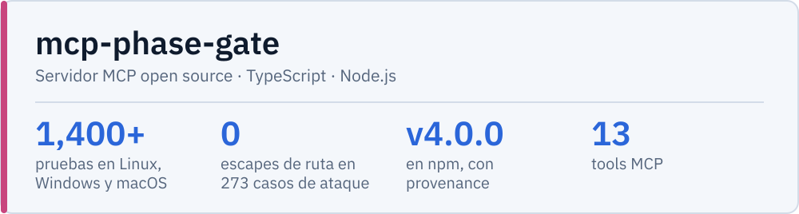
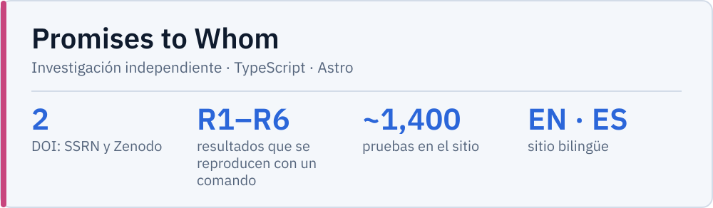
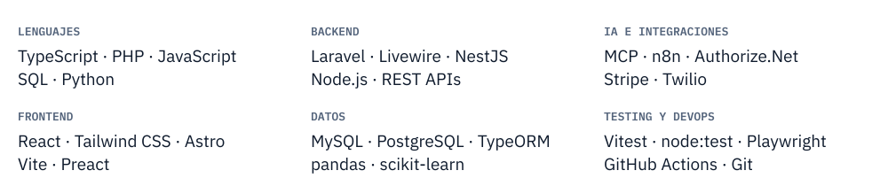
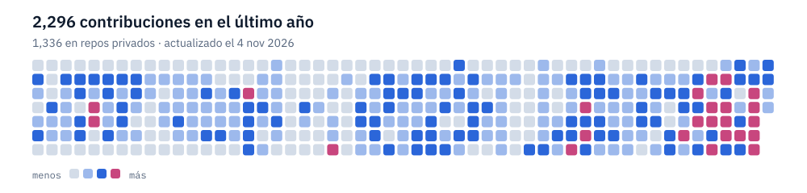

<picture><source media="(prefers-color-scheme: dark) and (max-width: 600px)" srcset="assets/banner-tall-dark.es.svg"><source media="(prefers-color-scheme: dark)" srcset="assets/banner-wide-dark.es.svg"><source media="(max-width: 600px)" srcset="assets/banner-tall-light.es.svg"></picture>

<a href="README.md"><picture><source media="(prefers-color-scheme: dark)" srcset="assets/btn-lang-dark.es.svg"></picture></a>
<a href="CV_HernandezGallegos_Montserrat_ES_GitHub.pdf"><picture><source media="(prefers-color-scheme: dark)" srcset="assets/btn-cv-dark.es.svg"></picture></a>
<a href="https://www.linkedin.com/in/montserrat-ximena-hern%C3%A1ndez-gallegos-536195276"><picture><source media="(prefers-color-scheme: dark)" srcset="assets/btn-linkedin-dark.es.svg"></picture></a>
<a href="mailto:gallegos230804@gmail.com"><picture><source media="(prefers-color-scheme: dark)" srcset="assets/btn-mail-dark.es.svg"></picture></a>

Soy ingeniera de software, de San Luis Potosí, México. Trabajo full stack en sistemas internos, sobre todo en el backend: integraciones de pago, REST APIs y webhooks, y agentes de IA conectados por MCP. Siempre he dicho que no soy programadora, soy ingeniera, y un ingeniero resuelve problemas. Para mí eso significa entender el problema antes de escribir código y, cuando algo en mi trabajo se repite, construir algo que lo resuelva.

### Proyectos

<picture><source media="(prefers-color-scheme: dark) and (max-width: 600px)" srcset="assets/card-mpg-tall-dark.es.svg"><source media="(prefers-color-scheme: dark)" srcset="assets/card-mpg-wide-dark.es.svg"><source media="(max-width: 600px)" srcset="assets/card-mpg-tall-light.es.svg"></picture>

<a href="https://www.npmjs.com/package/mcp-phase-gate"><picture><source media="(prefers-color-scheme: dark)" srcset="assets/btn-npm-dark.es.svg"></picture></a>
<a href="https://montse2308.github.io/mcp-phase-gate/demo/"><picture><source media="(prefers-color-scheme: dark)" srcset="assets/btn-demo-dark.es.svg"></picture></a>
<a href="https://github.com/Montse2308/mcp-phase-gate"><picture><source media="(prefers-color-scheme: dark)" srcset="assets/btn-source-dark.es.svg"></picture></a>

<picture><source media="(prefers-color-scheme: dark) and (max-width: 600px)" srcset="assets/card-pw-tall-dark.es.svg"><source media="(prefers-color-scheme: dark)" srcset="assets/card-pw-wide-dark.es.svg"><source media="(max-width: 600px)" srcset="assets/card-pw-tall-light.es.svg"></picture>

<a href="https://whykeepapromise.org"><picture><source media="(prefers-color-scheme: dark)" srcset="assets/btn-site-dark.es.svg"></picture></a>
<a href="https://doi.org/10.2139/ssrn.7580218"><picture><source media="(prefers-color-scheme: dark)" srcset="assets/btn-paper-dark.es.svg"></picture></a>
<a href="https://doi.org/10.5281/zenodo.23222610"><picture><source media="(prefers-color-scheme: dark)" srcset="assets/btn-engine-dark.es.svg"></picture></a>
<a href="https://github.com/Montse2308/promises-to-whom-engine"><picture><source media="(prefers-color-scheme: dark)" srcset="assets/btn-source-dark.es.svg"></picture></a>

### Herramientas con las que trabajo

<picture><source media="(prefers-color-scheme: dark) and (max-width: 600px)" srcset="assets/stack-tall-dark.es.svg"><source media="(prefers-color-scheme: dark)" srcset="assets/stack-wide-dark.es.svg"><source media="(max-width: 600px)" srcset="assets/stack-tall-light.es.svg"></picture>

### Actividad

<picture><source media="(prefers-color-scheme: dark) and (max-width: 600px)" srcset="assets/activity-tall-dark.es.svg"><source media="(prefers-color-scheme: dark)" srcset="assets/activity-wide-dark.es.svg"><source media="(max-width: 600px)" srcset="assets/activity-tall-light.es.svg"></picture>

Ingeniería en Sistemas Inteligentes, UASLP · Premio Ceneval al Desempeño de Excelencia-EGEL Fuera del código: fútbol, rugby y gym, poesía y filosofía, física, y el aire libre.
