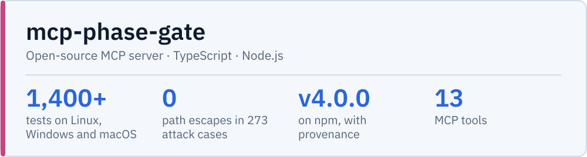
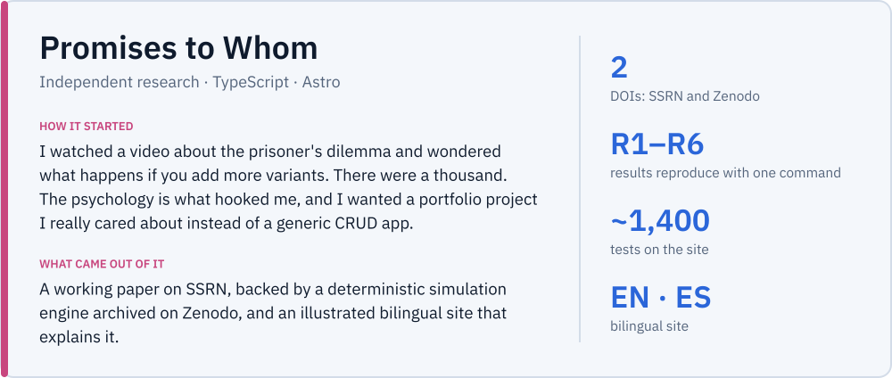
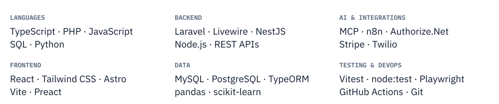
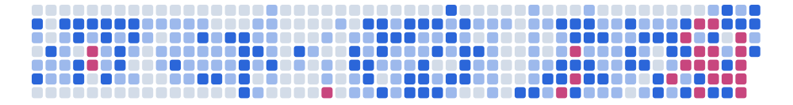

<picture><source media="(prefers-color-scheme: dark) and (max-width: 600px)" srcset="assets/banner-tall-dark.en.svg"><source media="(prefers-color-scheme: dark)" srcset="assets/banner-wide-dark.en.svg"><source media="(max-width: 600px)" srcset="assets/banner-tall-light.en.svg"></picture>

<a href="README.es.md"><picture><source media="(prefers-color-scheme: dark)" srcset="assets/btn-lang-dark.en.svg"></picture></a>
<a href="CV_HernandezGallegos_Montserrat_EN_GitHub.pdf"><picture><source media="(prefers-color-scheme: dark)" srcset="assets/btn-cv-dark.en.svg"></picture></a>
<a href="https://www.linkedin.com/in/montserrat-ximena-hern%C3%A1ndez-gallegos-536195276"><picture><source media="(prefers-color-scheme: dark)" srcset="assets/btn-linkedin-dark.en.svg"></picture></a>
<a href="mailto:gallegos230804@gmail.com"><picture><source media="(prefers-color-scheme: dark)" srcset="assets/btn-mail-dark.en.svg"></picture></a>

I'm a software engineer from San Luis Potosí, Mexico. I work full stack on internal systems, mostly on the backend: payment integrations, REST APIs and webhooks, and AI agents connected through MCP. I've always said I'm not a programmer, I'm an engineer, and an engineer solves problems. For me that means understanding the problem before writing code, and when something in my work keeps repeating, building something to fix it.

### Projects

<picture><source media="(prefers-color-scheme: dark) and (max-width: 600px)" srcset="assets/card-mpg-tall-dark.en.svg"><source media="(prefers-color-scheme: dark)" srcset="assets/card-mpg-wide-dark.en.svg"><source media="(max-width: 600px)" srcset="assets/card-mpg-tall-light.en.svg"></picture>

<a href="https://www.npmjs.com/package/mcp-phase-gate"><picture><source media="(prefers-color-scheme: dark)" srcset="assets/btn-npm-dark.en.svg"></picture></a>
<a href="https://montse2308.github.io/mcp-phase-gate/demo/"><picture><source media="(prefers-color-scheme: dark)" srcset="assets/btn-demo-dark.en.svg"></picture></a>
<a href="https://github.com/Montse2308/mcp-phase-gate"><picture><source media="(prefers-color-scheme: dark)" srcset="assets/btn-source-dark.en.svg"></picture></a>

<picture><source media="(prefers-color-scheme: dark) and (max-width: 600px)" srcset="assets/card-pw-tall-dark.en.svg"><source media="(prefers-color-scheme: dark)" srcset="assets/card-pw-wide-dark.en.svg"><source media="(max-width: 600px)" srcset="assets/card-pw-tall-light.en.svg"></picture>

<a href="https://whykeepapromise.org"><picture><source media="(prefers-color-scheme: dark)" srcset="assets/btn-site-dark.en.svg"></picture></a>
<a href="https://doi.org/10.2139/ssrn.7580218"><picture><source media="(prefers-color-scheme: dark)" srcset="assets/btn-paper-dark.en.svg"></picture></a>
<a href="https://doi.org/10.5281/zenodo.23222610"><picture><source media="(prefers-color-scheme: dark)" srcset="assets/btn-engine-dark.en.svg"></picture></a>
<a href="https://github.com/Montse2308/promises-to-whom-engine"><picture><source media="(prefers-color-scheme: dark)" srcset="assets/btn-source-dark.en.svg"></picture></a>

### Tools I work with

<picture><source media="(prefers-color-scheme: dark) and (max-width: 600px)" srcset="assets/stack-tall-dark.en.svg"><source media="(prefers-color-scheme: dark)" srcset="assets/stack-wide-dark.en.svg"><source media="(max-width: 600px)" srcset="assets/stack-tall-light.en.svg"></picture>

### Activity

<picture><source media="(prefers-color-scheme: dark) and (max-width: 600px)" srcset="assets/activity-tall-dark.en.svg"><source media="(prefers-color-scheme: dark)" srcset="assets/activity-wide-dark.en.svg"><source media="(max-width: 600px)" srcset="assets/activity-tall-light.en.svg"></picture>

B.Eng. in Intelligent Systems Engineering, UASLP · CENEVAL Award for Excellence (EGEL national exit exam) Outside of code: football, rugby and the gym, poetry and philosophy, physics, and being outdoors.
